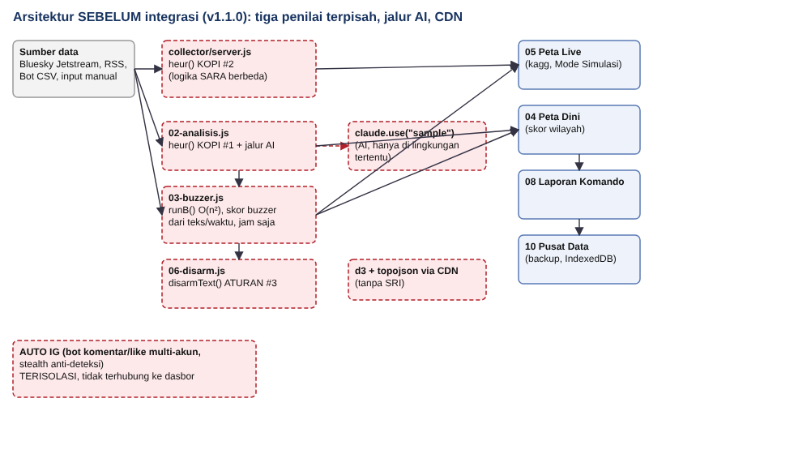
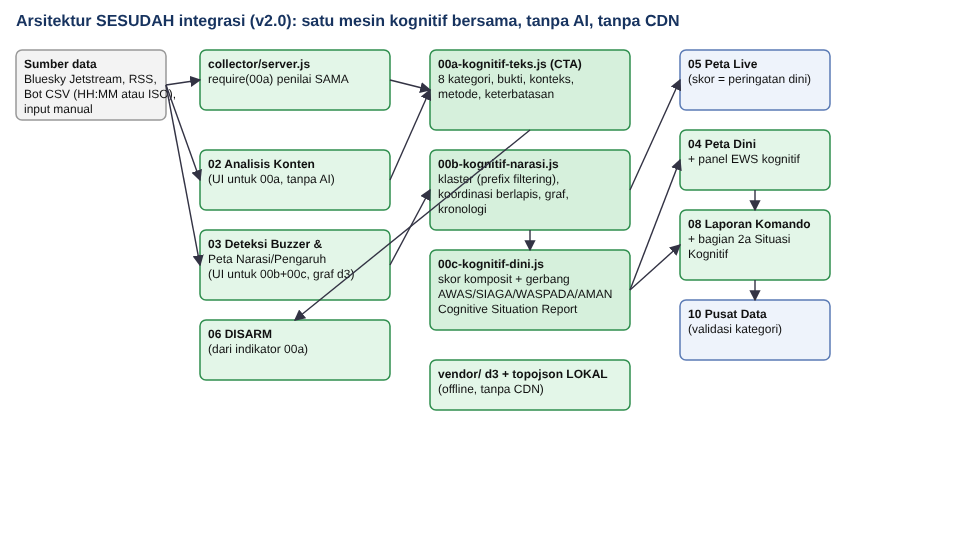

# ARCHITECTURE, Kartika Shield Cognitive Warfare v2.0

## 1. Prinsip desain
1. **Tanpa AI.** Seluruh analisis berbasis aturan (leksikon dan pola), statistik, kesamaan teks (Jaccard), korelasi waktu, analisis graf, dan skor indikator berbobot. Tidak ada panggilan ke layanan AI; tidak ada teks yang keluar dari peramban (CSP membatasi koneksi keluar).
2. **Satu penilai.** Mesin kognitif tunggal (`js/00a/00b/00c`) dipakai peramban dan kolektor Node (`require`), menutup tiga implementasi yang menyimpang pada v1.1.0 (B-09).
3. **Indikator, bukan putusan.** Tiap hasil memuat indikator, bukti, metode, keterbatasan, dan tingkat keyakinan. Kesamaan teks/waktu saja tidak menyimpulkan koordinasi; skor tidak menyimpulkan niat jahat.
4. **Dapat ditelusuri.** Setiap angka di dasbor berasal dari baris data masukan (`id` baris tercatat pada klaster, sisi graf, peringatan dini, dan laporan).
5. **Arsitektur lama dipertahankan.** HTML + JS murni, satu berkas build, kolektor Node tanpa dependensi.

## 2. Diagram

### Sebelum (v1.1.0)

### Sesudah (v2.0)

Hubungan data baru: `rows (CSV)` → `KS.narasi.analisis` → `KS.dini.peringatanDini` → (a) Peta Live (`kBuzz`, risiko = skor peringatan dini), (b) Peta Dini (`#bpm` mengirim catatan per provinsi+narasi; panel EWS membaca `lastR.D`), (c) Laporan Komando (`rSnap().kognitif = laporanSituasi(...)`), (d) ekspor JSON.

## 3. Pemetaan materi Cognitive Warfare → kemampuan aplikasi
Materi: carousel Instagram *"Ruang Pikiran sebagai Domain Medan Perang"* (sumber sekunder; rujukan NATO ACT/Burda 2024 pada slide **belum diverifikasi**). Konsep dipakai sebagai kerangka, bukan dikutip.

| Konsep pada materi | Diwujudkan sebagai | Batas |
|---|---|---|
| Disinformasi, klaim tanpa dasar | CTA: `FRAMING` (konspirasi/penyembunyian), `TIDAK_TERVERIFIKASI`; konteks bantahan | Tidak memeriksa kebenaran fakta |
| Manipulasi persepsi, operasi psikologis (pesan menakutkan/membingungkan) | `KETAKUTAN`, `EMOSI` | Leksikal; tidak paham sarkasme |
| Clickbait, headline sensasional | `CLICKBAIT` | |
| Polarisasi, bias kognitif, "kita vs mereka" | `POLARISASI`, `FRAMING` (dikotomi) | |
| Provokasi dan mobilisasi | `PROVOKATIF` | Metafora olahraga dapat salah tandai |
| Ilusi konsensus, pengulangan pesan | `REPETISI` (intra-teks), klaster narasi, pengulangan (EWS) | Tidak membuktikan niat |
| Algoritma media sosial, echo chamber/filter bubble | **Tidak diukur** (butuh data graf pengikut/rekomendasi platform) | Hanya graf akun–narasi–tagar dari data yang diimpor |
| Influencer | Akun penghubung ≥ 2 narasi; jangkauan (log follower) pada komponen dampak | Endorsement influencer tidak terdeteksi |
| Deepfake/konten sintetis | Hanya **isyarat teks** (klaim "video palsu") → DISARM T0087.001 | Tidak mendeteksi media |
| Microtargeting, profiling biometrik/psikografis | **Di luar lingkup**; tidak ada data biometrik diproses | |
| Rantai pengaruh (viral → penguatan → polarisasi → FOMO) | Kronologi + komponen kecepatan/intensitas/koordinasi/dampak | Efek pada audiens tidak diukur |
| Dampak jangka panjang (*cognitive conditioning*) | **Tidak terukur** | Tidak diklaim |
| Ketahanan kognitif, literasi | Langkah tabayyun, tautan cek fakta, narasi tandingan, rekomendasi respons **defensif** | |

## 4. Modul dan formula

### 4.1 Cognitive Threat Analysis (`00a-kognitif-teks.js`)
- **Normalisasi:** huruf kecil, NFKC, URL dan @mention dibuang, huruf dipisah spasi/titik disatukan, huruf berulang diringkas, angka→huruf pada kata campuran (dua versi: *mentah* dan *leet*; pola dicocokkan pada keduanya).
- **Katalog:** 24 indikator (+ S01 dinamis untuk SARA) dalam 8 kategori (`EMOSI`, `KETAKUTAN`, `CLICKBAIT`, `FRAMING`, `POLARISASI`, `PROVOKATIF`, `REPETISI`, `TIDAK_TERVERIFIKASI`). Tiap indikator: bobot, keyakinan pola (0–1), teknik, bukti kutipan.
- **Skor:** nilai indikator = bobot × keyakinan × (1 + 0,3 × (jumlah kecocokan−1, maks 2)). Skor kategori = jumlah nilai dibatasi batas kategori (EMOSI 20, KETAKUTAN 25, CLICKBAIT 20, FRAMING 25, POLARISASI 35, PROVOKATIF 25, REPETISI 10, TIDAK_TERVERIFIKASI 15). **Risiko = min(100, jumlah skor kategori).**
- **Faktor konteks:** bantahan bersumber ×0,2 (indikator "tanpa sumber" ditiadakan); kemungkinan bantahan ×0,5; konteks warga/sipil ×0,5 untuk emosi/ajakan; "ajakan menyebarkan" tanpa kategori kuat lain ×0,4; "tanpa sumber" hanya dihitung bila ada indikator lain.
- **SARA:** kata identitas **bersama** pola ancaman/konspirasi/permusuhan (bukan kata identitas saja) → +15 dan bendera `sara`.
- **Aturan lantai:** dehumanisasi/kekerasan terhadap kelompok → minimal 65 (kecuali konteks bantahan).
- **Ambang:** ≥65 RISIKO TINGGI · ≥45 RISIKO SEDANG · ≥20 PERLU DIVERIFIKASI · <20 RISIKO RENDAH.
- **Keyakinan:** tinggi (≥3 kategori kuat, ≥10 kata, tanpa konteks bantahan) / sedang / rendah (teks pendek atau bantahan bersumber).

### 4.2 Narrative & Influence Mapping (`00b-kognitif-narasi.js`)
- **Masukan:** `{u, age, fo, fi, tm | ts, tx, pv, id}`. Waktu: `HH:MM` (tanpa tanggal) atau `YYYY-MM-DDTHH:MM`.
- **Klaster:** duplikat persis → satu grup; sisanya dengan **prefix filtering** pada himpunan kata isi (kandidat dijamin muncul bila Jaccard ≥ ambang; pemindaian dibatasi 150/kata dan 2 perbandingan/klaster kandidat). Terhubung bila Jaccard bigram ≥ 0,5 **atau** Jaccard kata isi ≥ 0,7 (≥ 4 kata). Union-find membentuk klaster.
- **Konten bantahan** (penanda bantahan pada teks) dikecualikan dari "penguat" dan dihitung terpisah.
- **Koordinasi per klaster (0–100)**, bukti per indikator:

| Kode | Keluarga | Syarat | Poin |
|---|---|---|---|
| K1 | Teks | ≥10 / ≥5 / ≥3 / 2 akun berbeda, teks nyaris sama | 25 / 20 / 15 / 6 |
| K2 | Waktu | ≥3 akun dalam 5 menit dan ≥50% / ≥30% unggahan punya pasangan | 20 / 10 |
| K3 | Profil | ≥50% akun (≥3) berumur <30 / <90 hari | 20 / 10 |
| K4 | Profil | ≥3 akun berumur seragam (±1 hari), median <90 hari | 10 |
| K5 | Profil | ≥40% akun (≥2) bernama berpola angka | 10 |
| K6 | Profil | following ≥ 10×follower dan ≥100, ≥40% akun | 5 |
| K7 | Tagar | tagar identik dari ≥3 akun | 5 |

  **Pagar prinsip:** tanpa indikator profil, skor dibatasi 60; hanya satu keluarga, dibatasi 40. Kategori: ≥75 indikasi kuat · ≥50 sedang · ≥25 lemah · <25 tidak ada indikasi. Setiap klaster menyertakan *penjelasan alternatif* (kampanye sah, relawan, berita bersama, pesan berantai organik).
- **Status akun (berlapis):** skor = profil (≤52) + teks (28) + waktu (15). Label "Indikasi kuat tidak autentik" mensyaratkan skor ≥70 **dan** ≥2 sinyal profil **dan** korelasi teks/waktu; skor tinggi tanpa dukungan profil hanya "Perlu verifikasi".
- **Kronologi:** urutan per klaster (jam tanpa tanggal: dirotasi pada celah terbesar agar menangani tengah malam); peristiwa: muncul pertama, akun ke-3, bantahan pertama.
- **Graf:** simpul narasi/akun/tagar; sisi `unggah`, `tagar`, `serempak` (korelasi, bukan bukti hubungan). Tata letak d3-force dengan benih tetap (deterministik), maks 120 simpul berderajat tertinggi.

### 4.3 Cognitive Threat Early Warning (`00c-kognitif-dini.js`)
| Komponen | Bobot | Definisi (0–100) |
|---|---|---|
| Intensitas | 0,15 | 20 × log2(1 + akun berbeda) |
| Kecepatan | 0,15 | akun per 10 menit × 20 |
| Pengulangan | 0,10 | 100 × (1 − varian teks / unggahan), +10 bila >1,5 unggahan/akun |
| Manipulasi | 0,25 | 0,6 × rata-rata + 0,4 × maks skor CTA (sampel ≤25 unggahan) |
| Koordinasi | 0,15 | skor koordinasi klaster |
| Dampak | 0,20 | SARA +25, kebencian (indikasi) +25, sasaran sensitif +20, wilayah (≥3: +15; ≥1: +5), jangkauan ≤+15 |

**Level dan definisi:** AWAS (skor ≥75, ≥3 komponen ≥60, manipulasi ≥50, dampak ≥40) · SIAGA (≥50, ≥2 komponen ≥50, dan manipulasi ≥30 atau koordinasi ≥50) · WASPADA (≥25) · AMAN (<25). **Gerbang:** bila skor mencapai level tetapi syarat tambahan tidak terpenuhi, level diturunkan dan alasannya dicatat. Volume/kecepatan tinggi tanpa manipulasi tidak pernah menjadi AWAS/SIAGA (uji E07). Rekomendasi hanya defensif (verifikasi, klarifikasi bersumber, pelaporan resmi platform, literasi, dokumentasi bukti).

### 4.4 Cognitive Situation Report
`laporanSituasi(narasi, dini)` → ringkasan, level tertinggi, narasi dominan (3 teratas), indikator ancaman (rata-rata skor kategori), kronologi, wilayah relevan (hanya bila ada kode wilayah), bukti (kutipan), tingkat keyakinan (terendah di antara narasi dominan), rekomendasi defensif, batasan. Dirender pada Laporan Komando sebagai bagian **2a** (HTML, teks, JSON, CSV, cetak).

## 5. Model data
- **Peramban:** `localStorage` `bs_h` (riwayat analisis; kini memuat `c` = skor kategori), `bs_m` (laporan Peta Dini), `bs_rev`, `bs_cmd`, `bs_bk`; IndexedDB `kartika/kv` (`auto`, `undo`). Hasil narasi (`lastR`) hanya di memori sesi; ringkasannya masuk Laporan Komando.
- **Impor Buzzer:** `akun,umur_hari,follower,following,waktu,teks[|KODE]` (maks 20.000 baris, teks maks 2000 karakter, kode provinsi hanya bila dikenal).
- **Ekspor:** JSON hasil narasi + peringatan dini (`Ekspor hasil (JSON)`), Laporan Komando (HTML/teks/JSON/CSV).

## 6. Keamanan (ringkas; hasil uji di TEST_REPORT.md)
- Semua teks dinamis di-`esc()`; atribut/SVG graf di-escape; tidak ada `eval`/`Function`.
- CSP `<meta>`: `default-src 'none'`, skrip hanya lokal/inline, `connect-src` hanya `localhost`/`127.0.0.1` dan Jetstream Bluesky, `object-src/base-uri/form-action 'none'`. (`'unsafe-inline'` dibutuhkan build satu berkas; pertahanan utama terhadap XSS tetap `esc()`.)
- Kamus berkunci data pengguna memakai `Object.create(null)` (menutup crash `__proto__`/`constructor`).
- Pustaka d3/topojson lokal (`vendor/`), tanpa CDN.
- Kolektor: Host dan Origin diperiksa, POST wajib `application/json`, body ≤ 64 KB, klien SSE dibatasi, akun di-hash. **Residu:** Origin `null` (berkas lokal) diizinkan agar `file://` bekerja; bila `HOST=0.0.0.0` tidak ada autentikasi.
- Fitur otomasi interaksi media sosial dan anti-deteksi **tidak** ada di produk.

## 7. Keterbatasan arsitektur
Analisis berjalan di *main thread* (tanpa Web Worker): 20.000 baris data beragam ±7 detik pada mesin uji. Penilaian leksikal tidak memahami konteks/sarkasme. Kolektor `ambil-*.js` masih mengeluarkan jam `HH:MM` tanpa tanggal.
